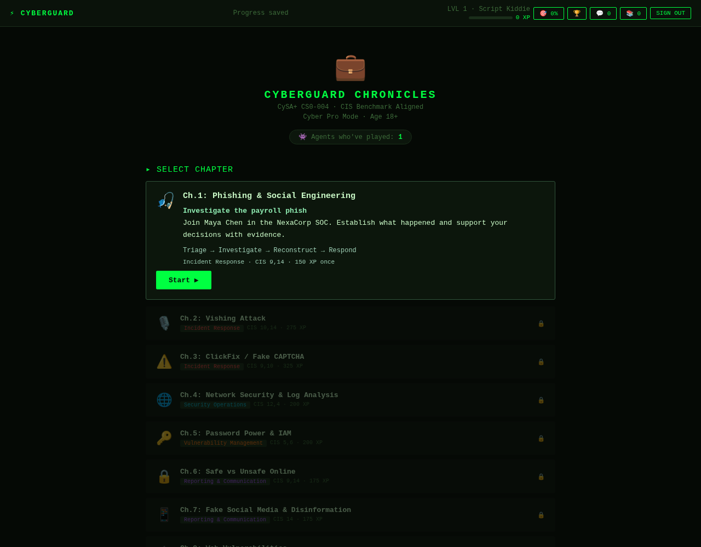
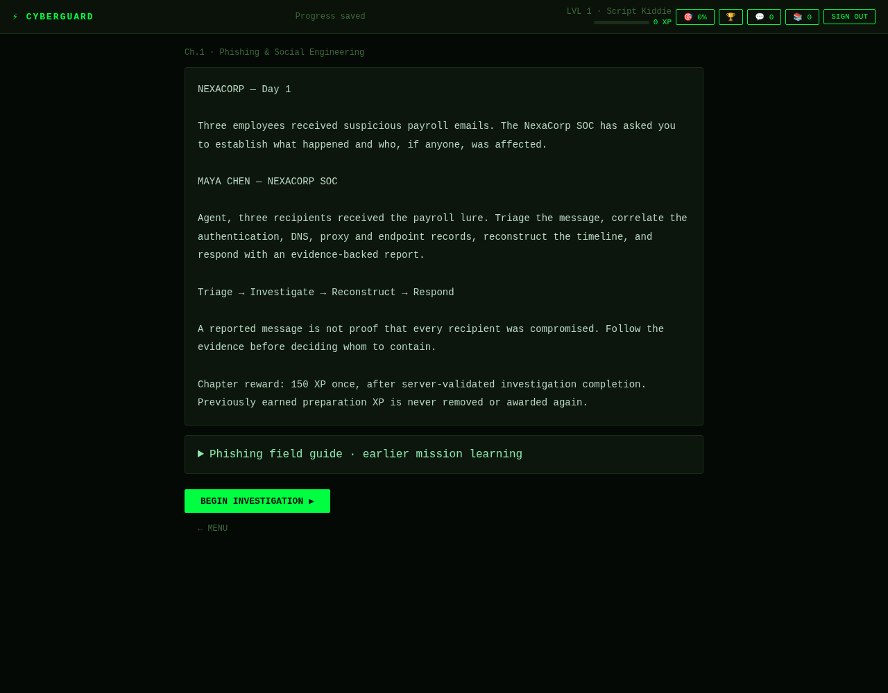

# Chapter 1: one connected payroll-phishing investigation

Chapter 1's normal card now owns **Investigate the payroll phish**. Its storyline introduces Maya Chen and the NexaCorp SOC alert, then leads into the existing investigation. The separate practical-lab banner is removed. Chapter 1 remains part of CyberGuard Chronicles; there is no duplicate simulation, framework migration, new paid service or Anthropic key requirement.

## Entry, stages and learning content

The Chapter 1 card shows **Start**, **Resume** or **Replay** according to the agent's saved chapter and investigation state. A new playthrough follows:

**Chapter 1 Play → Maya's briefing → Triage → Investigate → Reconstruct → Respond → assessed debrief → server-confirmed chapter completion.**

- **Triage** reuses the payroll message, sender identity, authentication headers, inert URL indicators and attachment metadata/preview.
- **Investigate** correlates the existing authentication, DNS, proxy and endpoint records. The event inspector, literal searches, entity pivots and constrained terminal share the same synthetic evidence.
- **Reconstruct** orders the incident timeline and records affected identities/endpoints and observables, keeping citations and private notes in the casebook.
- **Respond** records classification, severity, indicators, justified containment and an evidence-backed summary. The server grades the report and returns its debrief.

The former preparation missions' learning goals—recognizing phishing, distinguishing benign communication and verifying through a trusted channel—are retained in the investigation, guidance and debrief. New Chapter 1 play does not require a separate click-through quiz path. Other chapters retain their existing game flow.

The narrative says three employees **received** suspicious payroll messages; it does not declare three compromises. The investigation establishes that Alex submitted credentials and experienced unauthorized account access, Jordan's visit was blocked, and Sam reported the message. All domains, addresses, tools and containment actions are simulated.

## One reward rule, with historical XP preserved

The former **425 XP** allocation was a sum of three client-scored preparation quizzes (**100 + 100 + 75 = 275 XP**) and the server-validated **150 XP once-only investigation reward**. It was not a second 425-XP payout.

The integrated Chapter 1 now awards **150 XP once**, through the existing server reward ledger. It does **not** award an additional 425 XP, reissue the old 275 XP, deduct existing XP, or infer historical credits from total XP. The Chapter 1 allocation display reflects the current 150-XP reward.

| Saved history | Integrated experience and XP behavior |
| --- | --- |
| New agent with no Chapter 1 award | Earns 150 XP on the first complete, server-passed investigation. |
| Agent with some or all old preparation XP | Keeps the exact existing base-XP total; can earn the existing 150-XP investigation reward once if it has not already been paid. |
| Agent already paid the 150-XP investigation award | Keeps the award; completing or replaying the integrated chapter grants no additional reward. |
| Agent with Chapter 1 already completed before the integration | Keeps completion, badges and later-chapter access. Historical completion is grandfathered; it neither invents an investigation assessment nor creates extra XP. |
| Agent who later replays or submits a weaker report | Keeps any previously earned award and server-confirmed chapter completion. The new score/debrief describes that replay only. |

Legacy XP is stored as an aggregate client-written value. The repository has no trustworthy per-quiz award history: a mission index does not prove an answer earned XP, and past replays could award more than once. Preserving that aggregate unchanged is safer than guessing a 275-XP deduction or top-up.

As before, the UI projects the investigation ledger into the agent's displayed XP and subtracts it before writing legacy `user_progress.xp`. This keeps the bonus separate from historical base XP. New Chapter 1 gameplay does not run the old client quiz-award path.

## Server assessment and completion

New assessments are version 2. Every investigation objective must pass: email inspection/citation, classification, affected scope, correlation across **all four log sources**, a chronological incident timeline, indicators, proportionate containment and an evidence-backed severity report. Partial scores and explanations remain useful feedback, but a high score cannot bypass missing triage, a timeline or indicators.

The private grader stays on the server. Learner-provided scores, reward amounts, identity and completion flags are not trusted. Protected API operations validate the Supabase bearer session and use the verified user ID.

The existing transactional submission ledger remains the source of the one-time 150-XP award. Its monotonic award is proof of a previous server-passed investigation; the latest `result.passed` alone is unsuitable because a later replay may fail. Previously paid awards remain valid under the older assessment policy and are not clawed back by the stricter version-2 rubric.

Chapter completion is a separate server-confirmed operation after the debrief. It validates the stored award and expected revision before recording a monotonic `chapter_completed_at` timestamp. A browser callback or forged passing result is insufficient. Repeated completion requests are idempotent and grant no XP. The frontend merges confirmed completion into the existing chapter/codex/badge flow while retaining grandfathered completions.

The additive migration `supabase/migrations/20261024010000_integrate_chapter_one.sql` supplies this completion timestamp and service-only completion RPC, and freezes existing `done_chaps` Chapter 1 entries into server-owned grandfathered receipts without issuing XP. It keeps existing player data, ledger awards, RLS boundaries and submission receipts. **The migration is staged for review, not applied to production by this work.** Deploy the approved migration before the corresponding application release. A missing RPC must report an actionable service failure rather than claim that the chapter completed.

## Existing-save mapping and reliable resume

| Existing save | Mapping |
| --- | --- |
| Chapter 1 storyline/briefing | Restores the chapter briefing and enters the same payroll investigation. |
| Chapter 1 legacy preparation challenge/result at index 0, 1 or 2 | Enters the integrated investigation at Triage; historical XP, codex, badges and completion flags are retained. The retired quiz index is not treated as proof of a server-assessed objective. |
| Existing investigation at index 3 | Restores its existing version-1 workspace: panel, selected evidence, filters, inspected/cited evidence, notes, timeline, report, hints and last assessment. |
| Already completed Chapter 1 | Remains completed; later chapters stay unlocked. Replay opens the same investigation without resetting the one-time ledger. |
| Save in another chapter | Retains its chapter, mission and checkpoint; Chapter 1 integration does not remap it. |

Email maps to Triage; SIEM/terminal work maps to Investigate; the timeline maps to Reconstruct; the report maps to Respond. These stage labels organize the same persisted workspace, rather than creating a second progress store. The existing per-user/per-tab local backup, serialized revision-aware cloud saves, visible pending/saved/offline/error states, retry and explicit conflict resolution remain in use.

Draft activity and the last server assessment remain distinct. Existing records with no optional inspector selection still load; existing uncertain submission receipts retain their compatible fingerprint. A completion failure retains the assessment and draft so it can be retried after connectivity or service recovery.

## Verification and release boundaries

Run `npm test` and `npm run test:e2e`. The acceptance coverage should include Chapter 1 Play → briefing → each investigation stage → debrief → confirmed completion; stage-by-stage refresh/resume; logout/login; failed saves and completion retries; legacy save mappings; retained historical XP and badges; duplicate submissions and completion; cross-user denial; safe rendering; and other-chapter/auth/password-recovery regressions.

API tests explicitly reject skipped email inspection/citation, missing or unordered timelines, missing indicators and missing source citations even when the remaining score is high. SQL tests exercise the actual migrations in disposable PostgreSQL, including completion authorization, revisions and idempotency. Browser tests use isolated identities/progress fixtures with the real API/grader and disposable database; they do not establish production Supabase behavior. Record final test outcomes in the PR.

No production database changes, merge or deployment are authorized until the owner approves this new PR. Existing legacy chapters still use their prior client-written progress and XP trust model; this integration does not retroactively harden all historical scores or audit unknown deployed legacy RLS policies.

Compatibility during release: an existing legacy completion flag accompanied by the authoritative 150-XP pass proof remains visible even if an old client finished after the migration snapshot. The updated completion endpoint still establishes the durable receipt; a client flag without either a receipt or server pass proof cannot create a new completion. If the cloud service is unavailable, historical local progress remains usable, but a new Chapter 1 completion cannot be confirmed offline. Cached SOC metadata is not promoted into a newly verified receipt.

The chapter briefing also exposes the earlier sender/urgency/classification explanations and trusted-channel verification lesson as a non-rewarding, expandable phishing field guide. These reference examples are explicitly distinct from the payroll evidence.

Latest local verification: **68 Node/API/SQL tests passed** and the complete **31-scenario Chromium suite passed**. The full Start → briefing → investigation → completion → Chapter 2 case was also rerun after the chapter-typewriter guard change. Browser identity/progress use test fixtures with the actual API handler, grader and transactional SQL; production changes remain untested until approved migration and deployment.
