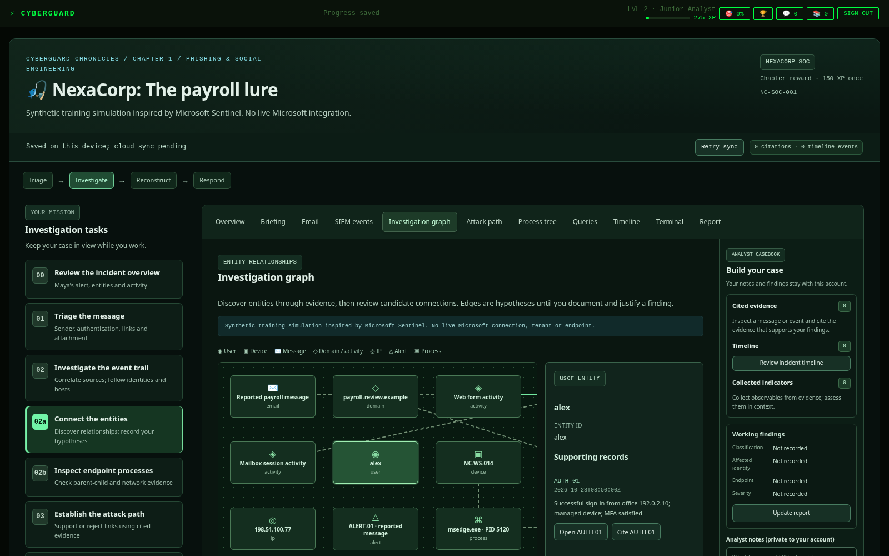
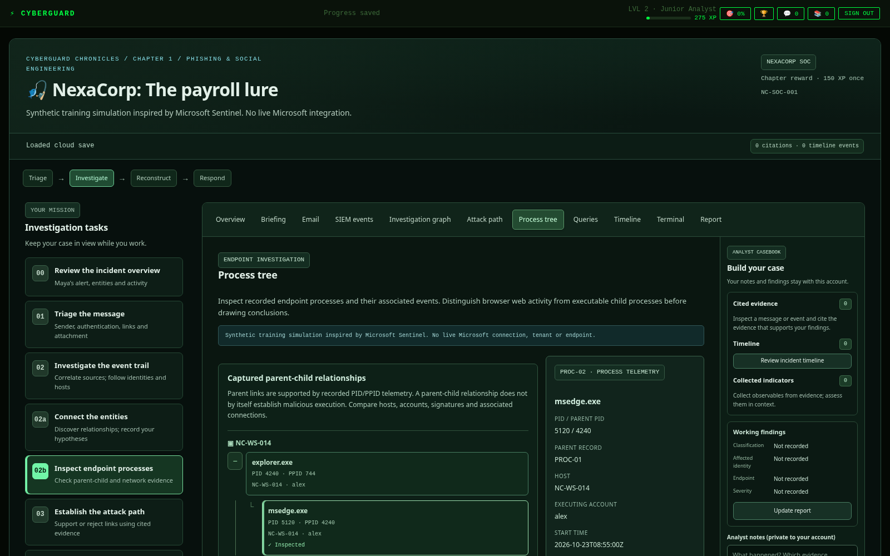

# Chapter 1 investigation console

The existing **NexaCorp: The payroll lure** investigation now has a Microsoft Sentinel–inspired console inside Chapter 1. It remains CyberGuard Chronicles, with the same Maya Chen storyline, synthetic payroll case, chapter entry, authentication, rewards and cloud storage. The console is explicitly labeled a **synthetic training simulation inspired by Microsoft Sentinel**, with no live Microsoft integration.

## Connected views and gameplay

The existing **Triage → Investigate → Reconstruct → Respond** stages organize these tools:

| View | Investigation activity |
| --- | --- |
| Incident overview | Inspect NC-SOC-001, its initial severity, owner, alerts, discovered entities and the analyst's evidence timeline. Initial alert severity is distinct from the learner's incident assessment. |
| Email and SIEM events | Reuse message headers, attachment metadata, literal search, source filters, indicators, event inspector and evidence citations. |
| Investigation graph | Select discovered users, devices, emails, domains, IPs, alerts and processes. Inspect supporting records, pivot to logs and annotate entities. |
| Attack path | Evaluate evidence-backed chronological relationships and an alternative endpoint-execution hypothesis. Record a verdict, select supporting evidence and explain the inference. |
| Process tree | Expand captured parent-child relationships, inspect a process, review its metadata and correlate its network evidence. |
| Queries | Run a documented KQL-style subset against the same synthetic dataset, with beginner examples and event pivots. |
| Timeline and analyst casebook | Preserve existing private notes, citations, indicators, ordered timeline, findings, incident report and server debrief. |

The graph reveals entities after their related evidence is inspected or cited. Relationships become available after all their supporting records have been investigated. Opening either graph creates no confirmed finding and awards no XP. Learners explicitly label each relationship as a hypothesis, analyst-confirmed or rejected/unsupported; those labels remain draft judgments until server assessment.





New assessments require the original report objectives plus a supported attack-path reconstruction and inspection of the relevant browser process. Relationship findings require the appropriate inspected and report-cited records, an explicit verdict and a rationale of at least 20 characters. Simply selecting a process or opening a graph cannot pass the case. The private server rubric remains outside browser assets; public scenario data includes candidate relationships and telemetry, not correct verdicts.

## Dataset additions and consistency

All original evidence identifiers, timestamps and text remain available. The added synthetic records make the existing credential-phishing finding inspectable without inventing malware execution:

- **EDR-04 / PROC-01:** Alex's `explorer.exe`, PID 4240, started at 08:40 UTC on NC-WS-014. Parent PID 744 is outside the capture.
- **EDR-05 / PROC-02:** Alex's legitimate `msedge.exe`, PID 5120, parent PID 4240, started at 08:55 UTC. It is associated with the existing browser activity in PROXY-01, PROXY-02 and EDR-01.
- **EDR-06 / PROC-03:** Sam's approved scheduled updater on NC-WS-031 is a benign distraction. Its related DNS-03 lookup does not establish a completed network connection.

File paths, command lines, account/host, signatures and available hashes are exposed consistently in process details and telemetry. Missing hashes and uncaptured parents are labeled unavailable. Browser network activity is correlated to the existing HTTPS proxy and DNS records; the updater has no observed connection to display. Signatures and hashes are synthetic fixture metadata, not reputation-service results.

The observed incident remains payroll lure → web form submission → unfamiliar successful identity access → mailbox session activity. EDR-01 still reports no executable child, download or persistence. A possible payload-execution branch is a hypothesis to assess against endpoint evidence, not an observed malware chain. Jordan's blocked request and Sam's official intranet visit/report remain useful benign distinctions.

## Queries and safety

The editor supports only the documented tables `SecurityEvents`, `EmailEvents`, `SigninLogs`, `DnsEvents`, `ProxyEvents` and `DeviceEvents`. Table and column names are case-insensitive. The literal search remains available for beginners.

```text
ProxyEvents
| where user == "alex"
| project id, time, user, detail
| sort by time desc
| take 2
```

Supported operators are `where`, `project`, `sort by` and `take`. Filters support exact equality/inequality, literal `contains`, `startswith`, one-word `has`, and integer comparisons. Multiple `where` stages combine filters. Supported columns and text-comparison behavior are documented in the editor. Unsupported syntax, unknown columns, malformed quotes and excessive limits return useful validation errors.

The parser is local and bounded: 2,000 characters, 12 operators, at most 5,000 source records and 100 returned rows. It has no eval, dynamic functions, SQL execution, shell execution, unrestricted regular expressions, network access, joins or external targets. Evidence, query text, errors, graph notes and report content are rendered as escaped text. No paid service or Anthropic key is introduced.

## Saves, assessment and rewards

The scenario ID stays `phishing-soc-v1`, workspace version stays 1 and the existing per-user JSON state gains an optional `console` extension. It stores the investigation stage, editor and last-run queries, selected entity/relationship/process, expanded and inspected processes, relationship judgments/evidence/rationales and entity notes. The existing `panel` restores the active view; all earlier notes, selected evidence, citations, timeline, report and assessment remain in their original fields.

No new database migration is required. Existing revision-aware writes, service-only assessment/completion RPCs, RLS, per-user/per-tab backup, visible sync status, retry and explicit conflict handling are reused. Object-key order differences from PostgreSQL JSONB do not count as analyst edits. Clean offline reconnect refreshes both the scenario and cloud state so an older device backup can acquire the new views.

Old cloud saves and local backups gain console defaults in the browser without losing earlier fields. An absent console extension remains absent during server validation, preserving the exact fingerprint of uncertain pre-upgrade submission retries. Old submission receipts, earned 150-XP rewards and grandfathered completion receipts remain valid. Older incomplete reports can resume and add the new findings; a new submission uses assessment version 3 and requires all ten objectives. A completed or previously rewarded agent keeps completion and XP even if a later replay fails.

The chapter reward remains **150 XP once**, using the unchanged transactional ledger. The new 100-point assessment rubric is not an XP grant. Opening views, running queries, resubmitting and completing again never create another reward. Existing legacy base XP, badges and later-chapter unlocks retain their previous behavior. See [the Chapter 1 integration](chapter-one-integration.md) for historical progress mappings and reward rules.

## Verification and release

Run `npm test` and `npm run test:e2e`. Coverage includes query parsing/filtering/projection/sorting and rejection, consistent graph/process records, strict state validation, old receipt fingerprints, attack-path/process requirements, graph-to-log pivots, selected view/query/annotations/process resume, refresh/logout/login, cross-user isolation, mobile rendering and injection. Existing assessment/reward, offline/retry/conflict, chapter entry/completion, authentication, password-recovery and other-chapter regressions remain in the suite.

Automated browser tests use isolated authentication/progress fixtures with the real API handler, grader and disposable PostgreSQL. They do not validate production Supabase or Microsoft Sentinel. The report rationale check verifies a bounded meaningful-length explanation and the required evidence/verdicts; it does not semantically understand free text or prove that a human personally inspected each record. This is a deterministic learning simulation, with deliberately limited telemetry and query syntax.

Local verification: **82 unit/API/SQL/query tests passed** and the complete **42-scenario Chromium suite passed**. Screenshots above use isolated test profiles. Production verification, when authorized and performed, is recorded in the PR.

Automatic Vercel deployment of `feat/sentinel-investigation-workspace` is disabled. Owner approval is required before merging or deploying; no production schema changes are part of this upgrade.
