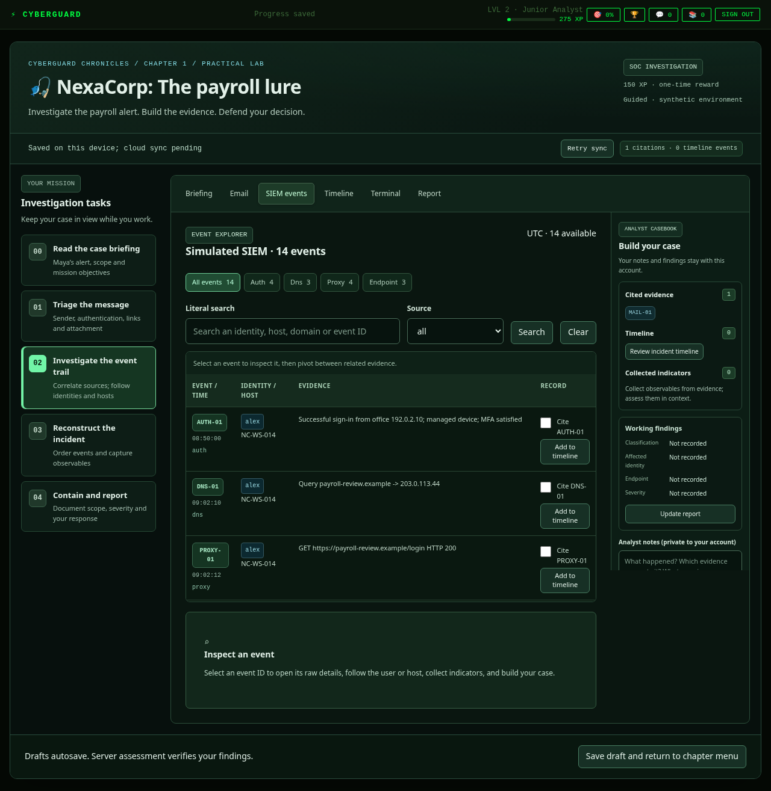

# From a mission form to an investigation workspace

> Historical design note: the Chapter 1 entry and reward flow are superseded by [the connected Chapter 1 integration](chapter-one-integration.md).
The first SOC release added a functioning investigation but kept the old chapter entry and a single column of forms. Learners still had to pass through the quizzes to find it, and could not keep tasks, evidence and findings in view together. This increment makes the practical lab a visible entry point and improves the investigation workflow without replacing the game.

## Learner journey

1. Open the featured **SOC investigation** from the existing chapter menu. Its own cloud draft is restored. All original chapters and the three preparation missions remain available with unchanged indices and rewards.
2. Keep the task rail visible while moving between email, SIEM, timeline, terminal and report. The rail distinguishes **not started**, **draft recorded** and **passed in the last assessment**. Drafting does not claim correctness.
3. Inspect the message as an email, read its authentication headers and review an inert attachment preview. Collect observable domains without assuming each is malicious.
4. In the event explorer, select an event to open its detail inspector. Search all sources for that user or host, compare relevant and benign activity, cite evidence, collect observables and add events to the timeline. A casebook keeps citations, indicators, working findings and private notes alongside the tools on desktop.
5. Reconstruct the sequence and fill the report's classification, scope, indicators and response sections. The existing server grader, debrief and one-time reward ledger remain authoritative.

The design uses CyberGuard's own dark green/cyan identity, Maya and NexaCorp. It takes the general practical-learning pattern of a persistent task panel and investigation tools as a reference; it copies neither platform's branding, proprietary labs or exact interface. These are simulated tools backed by one synthetic dataset, not a real remote VM.

## Save and compatibility behavior

There is **no new SQL migration**, scenario reset, reward change or framework migration. The only new saved state field is optional `selectedEvidence` in the existing version-1 JSON workspace. Old saves without it load normally; the server accepts only known evidence IDs. Submission fingerprints omit a null inspector selection so uncertain submissions from the previous release retain their idempotency receipts. Notes, reports, timeline, existing XP, badges, authentication and recovery retain their storage and behavior.

The direct launch opens Chapter 1 mission index 3. It does not award preparation-mission XP or clear completion data. Finishing the investigation uses the existing chapter-completion flow; this makes the original quizzes available as preparation rather than a prerequisite for opening the lab.

Server assessment criteria and the synthetic incident are unchanged in this increment. The added depth comes from evidence inspection, entity pivots, indicator collection and continuous case-building. This is not a full emulation of a commercial SIEM or terminal. See [the original simulation design](soc-investigation.md) for the data model, scoring, RLS, concurrency and remaining legacy limitations.

## Review and verification

Run `npm test` and `npm run test:e2e`. The existing browser suite still covers the full report and one-time reward, refresh, logout/login, device/tab conflicts, offline saves and injection handling. Additional browser checks cover direct entry, persistent tasks, event inspection and entity searches, citations/timeline selection, indicator deduplication and restore, and report-section navigation. Browser identities remain fixtures with the real grader/API handler and disposable PostgreSQL.

Desktop and mobile screenshots are captured during the browser tests. The feature branch disables automatic Vercel deployment. Open a PR and obtain approval before merging or deploying this increment.
